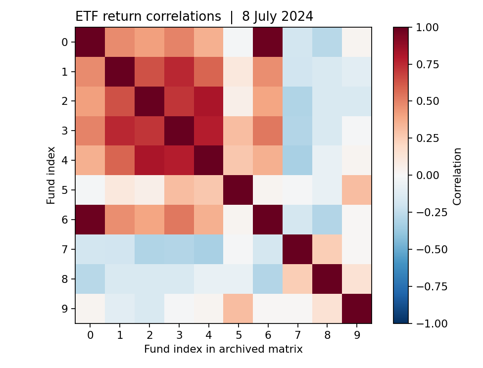

# ETF allocation with rolling risk estimates

How much information should an allocator carry forward from yesterday?

The research pipeline constructed 16 market features, scored them using historical information coefficients, and used LSTM forecasts for ten ETFs. The risk module assembled a covariance matrix from the preceding 100 daily returns. Keeping the allocation date out of that window matters because the portfolio needs its risk estimate before the next return is known.

The archived backtest recorded a 25.85% cumulative return against 18.60% for the CSI 300, with a maximum drawdown of 8.60% in magnitude. The public script reproduces the covariance calculation. The heatmap below uses the archived matrix for 8 July 2024.

## Run the example

From this project directory, using Python 3.12 in a virtual environment:

```sh
python -m pip install -r requirements.txt
python example.py
```



### Research pipeline

[score_factors.py](score_factors.py) computes the dynamic factor score. It updates its input CSVs in place, so put **working copies** under `data/etf-features/` inside this project. Each file represents one ETF and contains chronological daily prices, indicators and a forward return label. [train_lstm.py](train_lstm.py) trains each ETF separately and writes model checkpoints, predictions and evaluation plots. It additionally requires TensorFlow, scikit-learn and matplotlib. The archived training run supplies the portfolio-level results above.

**Historical replay.** Recomputing the risk input from ten local ETF price histories matched all 250 archived daily covariance matrices within numerical tolerance. Each calculation used 101 preceding prices for 100 returns.

## Original research code

The `data-engineering` scripts prepare the price panel. The `forecasting` directory contains the factor scoring, per-fund LSTM training and output processing. The `risk` directory computes historical covariance from a rolling window. I worked on this risk input and the portfolio backtest. This ETF study used historical covariance; the learned stock-correlation model belongs to a separate project.

[Browse the research source](research-source/) · [GitHub profile](https://github.com/BarryGreenton)
